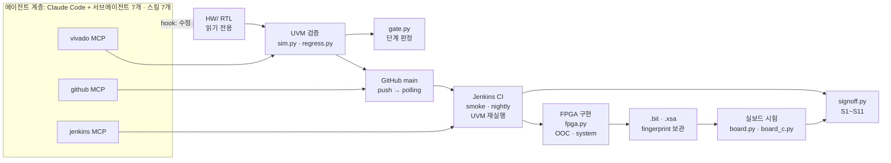

# dma_ip 검증·CI/CD 결과 보고서

작성 기준: 2026-11-21, main `4a46d4f`

## 요약

dma_ip(Zybo Z7-20)를 Vivado 2022.2 XSim 기반 UVM으로 검증했고, Jenkins CI, 비트스트림 CD, 실보드 시험, sign-off 판정까지 자동화했습니다. 2026-11-14에 P0~P6을 마쳤고, 그 뒤 ML 회귀, sign-off 기준(S1~S11), 에이전트 재설계, TB 재설계를 더했습니다. 2026-11-21 release 판정은 **조건부 출시**입니다. RTL 버그 7건 중 6건(BUG-002~007)이 open이고, waiver는 RTL 담당자의 결정을 기다립니다.

역할은 나눴습니다. 검증 방향, 범위, 판정 기준, 사양 해석과 사람 확인 지점(RTL 버그 등록, 검사 기준선 변경, 커밋)의 승인은 사람이 했습니다. 구현과 검토는 Claude Code 에이전트가 맡았고, 구현(`uvm-builder`)과 검토(`tb-reviewer`)를 서로 다른 에이전트로 나눴습니다. RTL은 외부 IP라서 읽기 전용이고, 에이전트는 고치지 않았습니다.

- **검증:** TB 6종(unit 5 + top 1), 테스트 29종(TB별로 세면 53개). 전체 회귀(seed 5개, main #40) 265회에서 예상과 다른 실패 0건이고, 실패하는 것은 알려진 RTL 버그 재현 테스트(XFAIL 50회 = `known_fail` 10개 × seed 5)뿐입니다.
- **커버리지:** 6개 TB(adder, adder8, fifo, fifo_d4, skid, top) 모두 기능 커버리지 100%입니다.
- **검증 계획:** 기능 45개를 `verif/plan.toml`에 두고, 가설 H1~H7을 directed test로 판정했습니다(모두 confirmed). 검사는 125개(ID 68종)이고 기준선과 비교합니다.
- **발견한 RTL 문제:** 버그 7건(BUG-001 won't fix, BUG-002~007 open)과 설계 노트 3건(NOTE-001~003)입니다.
- **sign-off:** 기준 S1~S11을 `scripts/signoff.py`가 결과 파일로 판정합니다. main #34(full)는 nightly PASS입니다.
- **CD와 보드:** 시스템 100MHz 타이밍을 통과했고(WNS +0.003ns, WHS +0.011ns), Zybo Z7-10 실보드에서 JTAG 시험 7/7, ARM C 프로그램 7/7이 PASS입니다.
- **자동화:** vivado MCP 도구 16개, 서브에이전트 7개, 스킬 7개, 규칙을 지키는 hook 세 겹을 갖췄습니다.

남은 결정은 RTL 담당자의 몫입니다. BUG-002~007의 waiver 승인, BUG-001 영향 재확인, NOTE-001(타이밍 여유) 근본 수정입니다.

## 바뀐 판단

11-14 보고서에서 판단이 바뀐 것입니다. 근거는 `verif/BUGS.md`와 `docs/UVM_STRUCTURE.md`에 있습니다.

| 11-14 판단 | 지금 | 이유 |
| --- | --- | --- |
| BUG-001은 보드에서 영향이 낮음 | 영향을 확인함. won't fix는 유지하되 RTL 담당자가 다시 확인할 일 | FIFO 입력은 리셋이 없는 adder 출력입니다. 작업 도중 리셋하면 이 경로가 걸립니다(BUG-006) |
| BUG-002는 `WVALID`를 W RUN 상태로 거르면 해결 | BUG-002~004를 함께 닫는 결합안: AW FIFO가 비지 않았고 W→B FIFO에 자리가 있을 때만 W를 냄 | 첫 작업 뒤에는 W FSM이 RUN에 남아 BUG-003이, B 응답이 느리면 BUG-004가 남습니다 |
| RAL 제거 (레지스터를 `write_reg`/`read_reg`로 직접 접근) | RAL(`uvm_reg`) 재도입. frontdoor는 `axil_reg_adapter`, 읽기값 비교는 `dma_predictor` | 예전 RAL은 volatile 필드와 정의되지 않은 비트를 비교하지 않았습니다. 지금은 정의되지 않은 비트도 RO 필드로 두고 32비트 전체를 비교합니다 |
| 검사는 job 실행 시퀀스가 판정 | monitor가 본 버스와 predictor가 만든 job으로 `dma_scoreboard`가 판정 | scoreboard와 coverage는 자극 쪽 sequence의 값을 쓰지 않습니다(`docs/UVM_STRUCTURE.md` 2절) |
| RTL 문제 3건 | 버그 7건 + 노트 3건 | TB 재설계에서 RTL을 읽고 세운 가설 7개를 판정했습니다 |
| 서브에이전트 5종과 verify-loop 스킬(지금은 없음) | 서브에이전트 7개, 스킬 7개 | 구현과 검토를 나누고 단계마다 gate로 판정하도록 재설계했습니다 |

## 전체 구조

RTL은 읽기 전용이고, 검증과 빌드는 모두 같은 스크립트(`sim.py`, `regress.py`, `fpga.py`)를 거칩니다. 사람, Jenkins, 에이전트가 모두 같은 경로를 쓰므로 로컬 결과와 CI 결과가 같습니다. 저장소 구성은 `docs/ARCHITECTURE.md`, 진행 흐름은 `docs/FLOW.md`가 원본입니다.



에이전트는 MCP로 검증, GitHub, Jenkins를 다루지만 `HW/` 수정은 hook이 막습니다. 판정은 글이 아니라 `gate.py`(단계)와 `signoff.py`(sign-off 기준)의 결과로 합니다. 단계별 산출물은 아래와 같습니다.

| 단계 | 산출물 |
| --- | --- |
| P0 | `sim.py`, XSim UVM 동작 확인, Windows XSim 문제 3건 우회 |
| P1 | 단위 UVM (fifo, skid, adder), BUG-001 발견 |
| P2 | top UVM, AXI4 메모리 모델, scoreboard, BUG-002 발견 |
| P3 | Jenkins CI (8090, JCasC), 병렬 regression |
| P4 | MCP 서버 3종 |
| P5 | 에이전트 규칙, RTL 보호 hook, 커버리지 100% |
| P6 | OOC 타이밍, 비트스트림 + XSA CD, NOTE-001 |
| 구조 재편 (`4b90bd1`) | UVM 코드를 파일 하나 = 클래스 하나로 정리, AXI4 slave를 driver/monitor로 분리, job 실행을 시퀀스로 이동 |
| ML 회귀 | 회귀 결과로 커버리지 모델을 학습해 smoke를 ML 회귀 계획으로 실행 (`ml_regress.py`) |
| Sign-off | 기준 S1~S9 자동 판정과 Jenkins Sign-off 단계 (`signoff.py`). release 판정과 보드 시험 |
| A단계 | 결과 출처(커밋, HW/ 해시), 검사 기준선, 검증 계획 데이터(`plan.toml`), `gate.py`, hook 세 겹, 문서 검사, CI 보강. 기준이 S1~S11로 늘어남 |
| B단계 | vivado MCP 재설계: worktree, 잠금, 작업 상태 파일, 판정 도구, 신호 추적 |
| C단계 | 서브에이전트 7개와 스킬 7개 재설계, 에이전트 정의 검사(`check_agents.py`) |
| TB 0-1, 0-2단계 | `verif/` 폴더를 테스트벤치 단위로 이동, 이름 바꾸기 (코드 동작 변경 없음) |
| TB 1단계 | top TB 재구성: RAL, 모니터 기반 predictor와 scoreboard, checker self-test |
| TB 2단계 | 새 시나리오와 가설 H1~H7 판정, RTL 버그 5건 추가 등록 |
| 마무리 | sign-off 기록, CLAUDE.md 규칙별 장치, 공개 저장소 반영 도구(`sync_public.py`) |

단계마다 `gate.py <단계>`가 PASS였습니다(결과는 `out/gate/<단계>.json`). 시각은 A 11-19 23:09, B 11-20 20:10, C 11-20 20:45, 0-1 11-20 21:23, 0-2 11-20 21:44, 1 11-21 13:25, 2 11-21 15:53이고, `static`은 11-21 20:32에 PASS였습니다.

## UVM 검증 환경

단위 블록 3개는 범용 valid/ready agent(`stream_agent`)로, 전체 DMA는 AXI4-Lite 마스터와 AXI4 메모리 모델로 검증합니다. 구조는 받은 참고 코드의 Agent/Driver/Monitor/Sequence 구성을 따르고, **파일 하나에 클래스 하나**(파일 이름 = 클래스 이름)로 정리했습니다. 재사용 VIP는 `verif/vip/`에 있고 DUT를 모릅니다. `*_pkg.sv`는 `` `include `` 목차만 담습니다. top TB의 레지스터는 RAL(`dma_reg_block`)의 frontdoor로 읽고 씁니다. 자세한 구조와 데이터 흐름은 `docs/UVM_STRUCTURE.md`가 원본입니다.

| 구성요소 | 역할 | 주요 검사 |
| --- | --- | --- |
| `stream_agent` (`verif/vip/stream/`) | 범용 valid/ready agent (MASTER, SLAVE, PASSIVE) | 핸드셰이크 유지, X 값 SVA |
| `unit_env` (`verif/unit/env/`) | fifo, skid buffer, adder 단위 env | 순서를 지키는 `unit_scoreboard`, 레인별 덧셈 모델(32bit, 8bit) |
| `axil_agent` (`verif/vip/axil/`) | AXI4-Lite 마스터. driver, monitor, RAL용 `axil_reg_adapter` | monitor가 본 접근마다 `axil_item`을 predictor로 보냄 |
| `axi4_slave_agent` (`verif/vip/axi4_slave/`) | DDR을 대신하는 AXI4 slave. driver(응답, 바이트 메모리)와 monitor(AR/AW/W/B 관찰)로 나뉨 | INCR, 8B 정렬, 16 beat 이하, 4KB 경계, WLAST 위치 |
| `dma_reg_block` (`verif/top/model/`) | RAL 모델. 레지스터 10개, 정의되지 않은 비트도 RO 필드 | 읽기값 32비트 전체 |
| `dma_predictor` | 사이클 모델로 모든 AXI-Lite 읽기값과 interrupt 핀을 예측하고, start를 받아들인 에지에서 job을 만듦 | `REG_RESET`, `REG_BITBASH`, `IRQ`, `REG_STATUS` |
| `dma_scoreboard` | monitor와 predictor가 본 것만으로 job마다 판정 | AR/AW/W 목록, dst 모든 바이트 = src + value_to_add[7:0], guard band, 원본 보존, beat 합계, 리셋 뒤 job 없는 버스 활동 |
| `dma_coverage` | 기능 커버리지 | job 크기 × 완료 모드, burst 길이, 4KB 분할 |
| `dma_ap_ctrl_sva.sv` | DUT 안쪽 ap_ctrl_hs 신호의 assertion 7개를 `bind`로 검사 | `APCTRL_SVA` |
| `dma_checker_test` | checker self-test. 결함을 일부러 넣고 그 결함을 잡아야 하는 검사가 오류를 내는지 확인 | 결함 5종 |

job 실행은 virtual sequence(`dma_job_vseq`, `verif/top/seq/`)가 맡습니다. SW 드라이버(`SW/mem_copy_test.c`)와 같은 순서로 레지스터를 쓰고, polling 또는 interrupt로 완료를 기다립니다. 목적지 영역은 미리 예상값의 반전값으로 채워, 쓰지 않은 바이트는 반드시 불일치로 잡힙니다. 연속 job(`dma_pipeline_vseq`), 작업 중 레지스터 쓰기(`dma_busy_reg_vseq`), 테스트 중간 리셋(`dma_reset_vseq`), 레지스터 bit-bash(`dma_reg_bitbash_vseq`)도 시퀀스입니다.

테스트 구성은 아래와 같습니다. 가설 테스트는 사양대로 기대를 검사하고, 가설이 맞으면 FAIL합니다.

| 구분 | 테스트 |
| --- | --- |
| top 기본 | `dma_reg_reset_test`, `dma_reg_bitbash_test`, `dma_smoke_test`, `dma_short_job_test`, `dma_rand_test`, `dma_4kb_cross_test`, `dma_backpressure_test`, `dma_irq_test`, `dma_size_edge_test`, `dma_long_job_test`, `dma_reset_test`, `dma_irq_ready_test`, `dma_busy_reg_write_test`, `dma_axil_timing_test`(AXI-Lite 타이밍 변화, 아래 한계 3) |
| top 검사기 시험 | `dma_checker_test` |
| top 가설, 버그 재현 (`known_fail`) | `dma_aw_backpressure_test`, `dma_aw_wait_after_job_test`, `dma_slow_b_test`, `dma_start_busy_test`, `dma_auto_restart_test`, `dma_reset_mid_job_test`, `dma_size_128mib_test` |
| unit | `unit_smoke_test`, `unit_post_reset_test`(BUG-001 재현), `unit_single_beat_test`(skid만), `unit_rand_test`, `unit_backpressure_test`, `unit_sparse_input_test`, `unit_fixed_value_test` |

top의 adder는 `C_ADDER_BIT_WIDTH = 8`로 8bit 레인이고, 그 설정을 그대로 단위 TB `adder8`에서도 검증합니다.

## 검증 결과

모든 regression에서 예상과 다른 실패는 0건입니다. XFAIL은 전부 `known_fail`로 등록한 RTL 버그 재현 테스트(BUG-001~007) 10개입니다. 결과는 SIGNOFF.md의 판정 기록 기준입니다.

| 실행 | 범위 | 실행 수 | 실패 | XFAIL | 시간 |
| --- | --- | --- | --- | --- | --- |
| 브랜치 `tb-redesign` #11 (smoke) | ML 계획 + 계획에 없는 테스트 | 58 | 0 | 10 | 13.6분 |
| 브랜치 `tb-redesign` #12 (full) | 모든 테스트 × seed 5 | 260 | 0 | 50 | 36분 |
| main #32 (smoke, `5b53124`) | 위와 같음 | 58 | 0 | 10 | 약 31분 |
| main #34 (full, `5b53124`) | 모든 테스트 × seed 5 | 260 | 0 | 50 | 41.6분 |
| main #40 (full, `2e8c451`) | 모든 테스트 × seed 5 (`dma_axil_timing_test` 포함) | 265 | 0 | 50 | 36.4분 |

main #32는 smoke sign-off PASS였고, #34와 #40(새 테스트 추가 뒤)은 nightly sign-off PASS였습니다. 재설계 전 마지막 full은 #28(205회, fail 0, XFAIL 20, 33.4분)입니다. 같은 seed 5개 기준으로 테스트가 41개에서 53개로(#40 기준), `known_fail`이 4개에서 10개로 늘었습니다.

| TB | 대상 | 테스트 | known_fail |
| --- | --- | --- | --- |
| `fifo`, `fifo_d4` | `sync_fifo` 깊이 64 / 4 | 6 | 1 (BUG-001) |
| `skid` | `skid_buffer` | 7 | 1 (BUG-001) |
| `adder`, `adder8` | `axis_adder` 32bit / 8bit 레인 | 6 | - |
| `top` | `dma_ip_top` | 21 | 7 (BUG-002~007) |

TB 목록의 원본은 `verif/sim_cfg.json`이고, 표는 `verif/README.md`에서 생성합니다.

기능 커버리지는 6개 TB 모두 100%입니다(top은 `cg_job`, `cg_burst`, unit은 `cg_beat`, `cg_cycle`). 이 100%는 bin 분포까지 본 값입니다. 11-14에 처음 본 100%는 XSim이 `$` 상한을 잘못 계산해 모든 job을 `huge` bin으로 세고 있었고, 고치자 실제는 97.6%였습니다. 그래서 점수만이 아니라 bin 분포도 의심합니다(S4, 이 확인은 아직 사람이 합니다). 그때 남은 구멍 2개(1 beat × interrupt, 512 beat × polling)는 `dma_size_edge_test`로 메웠습니다.

검사기가 실제로 오류를 내는지는 `dma_checker_test`가 확인합니다. 결함을 하나씩 일부러 넣고, 예상한 검사 ID가 나오는지 봅니다. 검사 목록은 기준선(`verif/check_baseline.json`, 125개)과 `check_inventory.py --compare`로 비교합니다. 검사를 줄여서 통과시키는 것은 규칙으로 막고(CLAUDE.md 규칙 5), 줄면 `gate.py static`이 실패합니다.

## 가설 판정

TB 재설계에서 RTL을 읽고 가설 7개를 세워 directed test로 확인했습니다. 절차는 `confirm-hypothesis` 스킬이 정합니다. 가설은 `verif/plan.toml`에 증거 줄과 판정을 적고, 모두 confirmed입니다. 가설마다 재현 테스트가 있고, 테스트는 `known_fail`로 등록돼 있습니다.

| 가설 | 내용 | 테스트 | 결과 |
| --- | --- | --- | --- |
| H1 | 작업 중 start는 실행되지 않고, 그 뒤 start도 리셋 전까지 무시됨 | `dma_start_busy_test` | BUG-005 |
| H2 | auto_restart는 한 번만 돌고 멈춤 (결과는 H1과 같고 내부 상태는 다름) | `dma_auto_restart_test` | BUG-005 |
| H3 | 작업 중 VALUE_TO_ADD를 바꾸면 그 뒤에 R로 받는 beat부터 새 값이 더해짐 | `dma_busy_reg_write_test` (PASS) | NOTE-002 (버그 아님, 동작으로 문서화) |
| H4 | 작업 도중 리셋하면 adder 잔여 beat가 AW 없는 W로 나감 | `dma_reset_mid_job_test` | BUG-006 |
| H5 | beat 카운터가 24비트라 128MiB 이상 전송이 잘림 | `dma_size_128mib_test` | BUG-007 |
| H6 | 작업을 한 번 끝낸 뒤 AWREADY가 늦으면 W FSM이 이전 burst 길이로 셈 | `dma_aw_wait_after_job_test` | BUG-003 |
| H7 | B 응답이 느리면 W→B FIFO가 넘쳐 B 항목이 버려짐 (AW 지연 불필요) | `dma_slow_b_test` | BUG-004 |

H3의 테스트만 PASS입니다. predictor가 이 동작을 beat 단위로 예측해 비교합니다. 가설 테스트는 노린 상태에 실제로 갔는지 버스 관찰로 확인하고, 못 갔으면 `SCENARIO_MISS` 에러입니다. gate의 `xfail_clean`은 XFAIL 로그에 `PRED_UNSUPPORTED`, `SCENARIO_MISS`, `UVM_FATAL`, timeout이 없는지 봅니다. 그래서 XFAIL이 TB 문제를 가리지 못합니다.

## 발견한 RTL 문제

검증에서 버그 7건과 설계 노트 3건을 찾았고, 원칙에 따라 `HW/`는 수정하지 않았습니다. 각 버그는 재현 테스트를 `known_fail`로 등록해 CI에서 XFAIL로 추적합니다. RTL이 고쳐지면 테스트가 통과(XPASS)하면서 CI가 실패해 알려줍니다. 등록은 `verif/BUGS.md` 기록, `plan.toml`의 bugs, `sim_cfg.json`의 `known_fail`이 서로 맞아야 하고(S2), 상태는 RTL 담당자가 정합니다. 증상, 원인, 수정안, 보드 영향은 `verif/BUGS.md`가 원본입니다.

| ID | 블록 | 증상 | 원인 | 상태 |
| --- | --- | --- | --- | --- |
| BUG-001 | `skid_buffer.v` (FIFO 안에도 사용) | 리셋 직후 첫 사이클에 들어온 데이터가 두 번 출력되고 이후 데이터가 한 칸씩 밀림 | `PIPE` 상태가 `s_ready_reg`를 보지 않고 `s_valid`를 받음 | won't fix (RTL 담당자 결정, 2026-11-14). 영향은 BUG-006에서 확인 |
| BUG-002 | `wdma.v` | 리셋 뒤 첫 작업에서 AWREADY가 늦으면 WLAST가 늦게 나오고 `ap_done`이 오지 않음 (hang) | `WVALID`가 W 상태 머신과 무관하게 나가는데, burst 카운터는 RUN 상태에서만 셈 | open |
| BUG-003 | `wdma.v` | 작업을 한 번 끝낸 뒤 AWREADY가 늦으면 W FSM이 이전 burst 길이로 W beat를 세어 WLAST가 틀리고 멈춤 | burst 끝에서 pop 전 `aw_fifo_empty_n`을 봐서 RUN에 남음 | open |
| BUG-004 | `wdma.v` | B 응답이 느리면 W→B FIFO(깊이 4)가 넘쳐 B 항목이 버려지고 멈춤 (AW 지연 불필요) | burst 끝의 `w_fifo_full_n`도 push 전 값이고, W 경로가 B 쪽 여유를 보지 않음 | open |
| BUG-005 | `dma_wrapper.v` (+ RDMA, WDMA 시작 로직) | 작업 중 start나 auto_restart 뒤에는 리셋 전까지 start가 먹지 않음 | `ap_start`를 에지로만 받고, RUN 중 펄스는 버려져 상태가 굳음 | open |
| BUG-006 | `axis_adder.v` | 작업 도중 리셋하면 adder 잔여 beat가 AW 없는 W로 나가 이후 작업 데이터가 조용히 밀림 (done은 정상) | adder의 always 블록에 리셋이 없음 | open |
| BUG-007 | `rdma.v`, `wdma.v` | 128MiB 이상 전송은 일부만 복사하고 done, 128MiB 배수면 멈춤 | beat 카운터가 24비트 | open |
| NOTE-001 | RDMA/WDMA burst 주소 계산 | 100MHz 타이밍 여유가 거의 없음 | 남은 beat, 16-beat 제한, 4KB 경계 계산을 한 사이클에 처리 | 구현 전략으로 통과. 근본 수정은 RTL 담당자 판단 |
| NOTE-002 | adder, `dma_ip_top.v` | 작업 중 VALUE_TO_ADD 변경은 그 뒤 R beat부터 적용 | 크기와 주소는 start에서 잡지만 VALUE는 레지스터에 바로 연결됨 | 사용자 결정: 동작으로 문서화 |
| NOTE-003 | `wdma.v`, `dma_ip_top.v` | 리셋이 걸린 뒤 2사이클 동안 WVALID가 1로 남음 | 리셋을 한 번 레지스터로 받아 씀 | 영향 낮음. RTL 담당자 참고 |

보드 구성(HP0 직결, 제공 SW의 사용 순서)에서는 이 버그들이 걸리지 않습니다. 걸리는 조건은 AWREADY나 B 응답 지연(BUG-002~004), 작업 중 start나 auto_restart(BUG-005), 작업 중 PL 리셋(BUG-006), 128MiB 이상 전송(BUG-007)입니다. 그래서 보드 시험 통과가 버그 없음을 뜻하지 않습니다.

수정안은 모두 `verif/BUGS.md`에 적었습니다. 요점은 아래와 같습니다.
- **BUG-001:** 입력 캡처를 `s_ready_reg`로 거릅니다. BUG-006을 고치면 이 경로의 BUG-001도 걸리지 않습니다.
- **BUG-002, 003, 004:** 결합안 하나로 닫습니다. `w_go = w_s_run_w & aw_fifo_empty_n & w_fifo_full_n`로 W를 내보내는 조건을 겁니다. 처음 제안(W RUN 상태로만 거름)으로는 BUG-003, BUG-004가 남습니다.
- **BUG-005:** wrapper가 level start를 두 블록이 모두 IDLE일 때 받습니다.
- **BUG-006:** adder의 valid 비트에 리셋을 넣습니다.
- **BUG-007:** beat 카운터를 29비트로 넓힙니다. `r_hs_data_cnt` 루프가 NOTE-001의 critical path라 넓히면 100MHz를 못 맞출 수 있어, NOTE-001 개선과 함께 `fpga.py`로 확인해야 합니다.
- **NOTE-001:** burst 길이를 `S_PRE` 사이클에 미리 계산해 레지스터에 담습니다.

## Sign-off와 release 판정

"검증이 끝났다"는 판정은 글이 아니라 `scripts/signoff.py`가 결과 파일로 합니다. 기준 S1~S11과 판정 수준(smoke, nightly, release)은 `verif/SIGNOFF.md`가 원본이고, Jenkins는 빌드마다 이 판정을 남깁니다(`out/signoff/signoff.md`).

| 기준 | 내용 |
| --- | --- |
| S1~S3 | 회귀 fail 0, 예상된 실패는 승인된 `known_fail`만, 모든 TB와 테스트를 seed 수 기준으로 실행 |
| S4, S5 | 기능 커버리지 100%, ML 회귀 계획의 목표 bin 183개 (S5는 smoke만) |
| S6, S7 | OOC와 시스템 빌드 타이밍 WNS, WHS ≥ 0, 비트스트림과 XSA |
| S8 | 실보드 시험 PASS (release만) |
| S9 | 검증 계획과 테스트, 검사 ID, 커버포인트가 서로 맞음 |
| S10, S11 | 근거 파일이 모두 같은 커밋에서 나옴, `HW/` 내용 해시가 승인된 값과 같음 |

판정을 처음 돌렸을 때 S9가 `dma_smoke_test`와 dma_small_test(지금 이름은 `dma_short_job_test`)가 vplan에 빠져 있는 것을 잡았고, 두 행을 추가해 고쳤습니다.

waiver는 `known_fail` 등록입니다. 재현 테스트를 등록하려면 BUGS.md에 버그가 있어야 하고(없으면 hook과 S2가 막습니다), RTL이 고쳐져 XPASS가 되면 S1이 실패해 등록을 지우게 합니다.

| 판정 | 근거 | 결과 |
| --- | --- | --- |
| release 2026-11-18 (재설계 전) | full #28(205회 fail 0, 시스템 WNS +0.003ns)과 보드 시험 2종 | PASS, 조건부 출시 (BUG-002 waiver). S1~S4, S6~S9 PASS |
| smoke #27 | ML 계획 47회 (Sign-off 단계 첫 실행) | smoke PASS |
| nightly `tb-redesign` #12, main #34, #40 | full 260회(#12, #34), 265회(#40, 새 테스트 포함) fail 0, xfail 50, 커버리지 6개 TB 100 | nightly PASS |
| release 2026-11-21 (재설계 뒤) | 커밋 `94accfa`, 수정 없는 checkout. full 260회, OOC, Z7-10 시스템 빌드, 보드 시험 2종 | PASS, 조건부 출시. S1~S4, S6~S11 PASS, S5는 smoke 전용이라 N/A |

2026-11-21 release 판정의 근거는 아래와 같습니다.
- 전체 회귀 seed 5: 260회 fail 0, XFAIL 50, 커버리지 6개 TB 100%
- OOC(xc7z020) WNS +0.014ns / WHS +0.125ns, 시스템 빌드(xc7z010) WNS +0.005ns / WHS +0.008ns, 비트스트림과 XSA
- Zybo Z7-10 보드: JTAG 7/7 PASS, ARM C 7/7 PASS
- `HW/` 해시 `9fdca2f0cc594a65` (승인값과 같음, checkout과 모든 근거)

조건부인 이유는 BUG-002~007이 open이고 waiver가 RTL 담당자 결정을 기다리기 때문입니다. 출시 노트에 적은 사용 조건은 아래와 같습니다.
- AWREADY나 B 응답을 늦추는 interconnect에서 쓰지 않습니다 (BUG-002, 003, 004).
- start는 idle 확인 뒤 한 번만 쓰고, auto_restart는 쓰지 않습니다 (BUG-005).
- 작업 도중 PL 리셋을 했다면 그 뒤 작업 결과를 신뢰하지 않습니다 (BUG-006).
- transfer_byte는 128MiB 미만으로 합니다 (BUG-007).
- BUG-001(won't fix)은 리셋 해제 직후 같은 사이클에 입력을 넣지 않습니다. NOTE-001은 타이밍 여유가 +0.003ns라, RTL이나 구현 설정을 바꾸면 S6, S7을 다시 확인합니다.

## CI/CD

이 PC의 별도 Jenkins(포트 8090)가 `main`에 push될 때마다 검증과 FPGA 타이밍 검사를 돌리고, nightly에는 비트스트림과 XSA를 만듭니다. 설정은 모두 코드(JCasC, `Jenkinsfile`)로 저장소에 있고, 8080 포트의 기존 Jenkins 서비스는 건드리지 않았습니다. 단계와 실패 기준은 `docs/FLOW.md` 2절의 표가 원본입니다.

| 트리거 | 실행 내용 |
| --- | --- |
| `main` push (5분 polling), smoke | `gate.py static`과 lint, ML 회귀 계획(47회)대로 unit과 top, 계획에 없는 테스트는 seed 1개씩 추가(합쳐서 58회), 계획 목표 bin 확인, DMA 단독 OOC 타이밍, smoke sign-off |
| nightly 02:00, full | 모든 TB의 모든 테스트 × seed 5(53개 × 5 = 265회), 기능 커버리지 HTML, 비트스트림 + XSA, nightly sign-off |
| 수동 | `MODE`, `SEEDS`, `BITSTREAM` 지정 |

smoke 빌드는 8.8~13.6분, full 빌드는 33.4~41.6분 걸렸습니다(SIGNOFF.md 판정 기록).

100MHz 시스템 타이밍은 구현 전략을 바꿔서야 통과했습니다. RTL과 블록 디자인은 그대로입니다.

| 빌드 | 구현 전략 | WNS | 실패 경로 수 |
| --- | --- | --- | --- |
| DMA 단독 (OOC, xc7z020) | 기본 | +0.014 ns | 0 |
| 원래 수동 프로젝트 | 기본 | -0.201 ns | 6 |
| CD 시스템 (`3e00943`) | 기본 | -0.347 ns | 12 |
| CD 시스템 (main #34, xc7z020) | `Performance_ExplorePostRoutePhysOpt` | +0.003 ns (WHS +0.011 ns) | 0 |
| CD 시스템 (xc7z010, Zybo Z7-10) | `Performance_ExplorePostRoutePhysOpt` | +0.005 ns (WHS +0.008 ns) | 0 |

main #34는 41.6분 걸려 SUCCESS로 끝났고, `design_1_wrapper.bit`(4,045,676 bytes)와 `design_1_wrapper.xsa`(679,401 bytes)를 fingerprint와 함께 보관했습니다. 스크립트의 `--part` 옵션으로 Z7-20과 Z7-10 빌드를 모두 만듭니다.

비트스트림에 들어가는 IP는 빌드할 때마다 `HW/`에서 다시 조립합니다. 기존 IP에 패키징된 RTL은 `HW/`와 바이트 단위로 같았습니다. 그래서 보드에 올라가는 회로는 검증한 RTL 그대로입니다. 보드에 올린 XSA가 승인된 RTL로 만든 시스템 빌드인지는 S10이 확인합니다.

CI 빌드 이력은 11-14 이후 #21~#28, `tb-redesign` 브랜치 #11과 #12, main 병합 뒤 #32와 #34입니다. smoke는 #21~#24가 예전 방식(36회), #25~#27이 ML 계획(47회)이고, #27에서 Sign-off 단계가 처음 돌았습니다. 전체 표는 `verif/SIGNOFF.md`에 있습니다.

빌드 로그의 "Selected Git installation does not exist. Using Default"는 무시해도 되는 메시지입니다. 원인과 정정 기록은 `ci/README.md`에 있습니다.

CI 첫 빌드에서 드러난 문제도 있었습니다. A단계 보완 커밋(`1275d59`)과, CI에서 S11이 FAIL한 원인이던 줄바꿈 차이를 LF로 맞춘 뒤 해시하도록 고친 커밋(`44a4c59`)입니다.

## 실보드 시험

CI에는 보드가 연결돼 있지 않습니다. 보드를 이 PC에 USB로 연결하고 사람이 돌리며, 결과는 release sign-off의 S8 근거입니다. 방법과 명령은 `ci/README.md`가 원본입니다. Zybo Z7-10에서 두 가지를 돌렸습니다. 2026-11-16~17에 처음 했고, 재설계 뒤 release 판정을 위해 2026-11-21에 다시 했습니다. 그동안 RTL은 바뀌지 않았습니다.

| 시험 | 방법 | 결과 |
| --- | --- | --- |
| JTAG (`board.py`) | xsdb로 비트스트림을 올리고 PS의 DDR을 초기화한 뒤, 시뮬레이션과 같은 레지스터 순서로 DMA를 실행. 대상 영역을 0xA5로 채워 두고 바이트마다 `(원본 + add) & 0xFF`와 비교 | 7/7 PASS (11-16, 11-21) |
| ARM C (`board_c.py`) | ARM(Cortex-A9)에서 C 프로그램(`fw/dma_board_test/dma_board_test.c`)이 DMA를 구동하고 스스로 판정. DDR mailbox와 UART 출력이 서로 맞는지도 확인 | 7/7 PASS (11-17, 11-21) |

JTAG 시험 7개는 8B(최소 전송)부터 1MB까지입니다. 대상은 한 beat, burst 하나, burst + 1 beat(8비트 lane 올림 버림), 정확히 4KB, 4KB 경계 통과, 64KB, 1MB입니다.

성능은 ARM C 프로그램으로 1MB를 옮길 때 쟀습니다. 1MB 전송에서 DMA는 787 MB/s이고, CPU memcpy는 366 MB/s입니다. 2026-11-21 재시험에서도 DMA 787 MB/s, memcpy 364 MB/s로 거의 같았습니다. 작은 크기에서 CPU가 빨라 보이는 것은 원본이 아직 cache에 남아 있기 때문입니다. 공정한 비교는 L2(512KB)보다 큰 1MB뿐입니다. DMA 시간에는 DONE 폴링 지연이 포함됩니다.

시뮬레이션에서 찾은 버그 7건은 이 시험에서 드러나지 않았습니다. 보드 구성과 제공 SW가 걸리는 조건을 피하기 때문입니다. 시뮬레이션에서 지연과 리셋을 일부러 넣는 시나리오가 필요한 이유입니다.

## ML 회귀

회귀를 얼마나 돌려야 커버리지가 닫히는지를 경험이 아니라 데이터로 정했습니다. 실행 820회(당시 등록된 TB·테스트 조합 41개 × seed 20개)의 bin 적중 기록으로 테스트마다 bin을 칠 확률을 학습하고(Beta-Bernoulli 사후 평균), 가장 적은 실행으로 커버리지를 닫는 회귀 계획을 만듭니다(`scripts/ml_regress.py`). 딥러닝이 아니라 확률 모델입니다.

학습에 쓰지 않은 seed에서 평가한 결과입니다. 테스트마다 seed를 반으로 나눠 절반으로 학습하고, 나머지 절반에서 계획대로 실행을 뽑아 모든 bin을 채우는지 셌습니다.

| 방식 | 실행 수 | 모든 TB 100% 도달 비율 |
| --- | --- | --- |
| nightly full (테스트당 seed 5개) | 205 | 100.0% |
| ML 계획 (모든 테스트 1회 이상) | 49 | 99.1% |
| 같은 실행 수를 무작위로 고름 | 49 | 43.5% |

nightly 205회를 49회로 줄인 값이 76% 절감입니다. 같은 실행 수라도 무작위 선택보다 100% 도달 확률이 높습니다. CI smoke는 이 계획(`verif/regress_plan.json`, 47회)으로 돌고, 끝나면 목표 bin 183개를 모두 채웠는지 확인합니다(S5). 못 채우면 UNSTABLE이고, 계획은 99.1%라 드물게 실패할 수 있습니다.

한계가 있습니다. 위 수치는 재설계 전 테스트 목록 기준입니다. 재설계에서 추가한 테스트는 학습 데이터에 없어서, smoke에서 계획과 별도로 seed 1개씩 돌립니다(그래서 smoke는 58회). 계획은 테스트나 covergroup을 바꾼 뒤 다시 만들어야 합니다(`ci/README.md`).

## MCP와 에이전트 오케스트레이션

에이전트가 시뮬레이션, CI, GitHub를 도구로 다루고, 서브에이전트가 계획부터 CI 확인까지 나눠 맡습니다. 사람은 RTL 버그 등록, 검사 기준선 변경, 커밋(과 push)을 승인합니다. 에이전트는 이 확인 지점에서 멈춥니다.

| MCP 서버 | 도구 | 등록 위치 |
| --- | --- | --- |
| `vivado` (직접 제작) | 16개: 시뮬레이션(list_testbenches, lint, run_test, trace_signals), 회귀(start_regression, regression_status, cancel_job, compare_regressions), 결과 확인(get_log_excerpt, coverage_report, list_known_bugs), 판정(check_inventory, run_gate, signoff), 작업 기록(ledger_append, ledger_read) | 저장소 `.mcp.json` |
| `jenkins` (공식 플러그인) | 23개 (getBuild, getTestResults, triggerBuild 등) | 로컬 설정 (토큰) |
| `github` (공식 원격 서버) | PR, issue, review 등 | 로컬 설정 (토큰) |

`vivado` 서버는 `sim.py`를 그대로 호출해 에이전트가 보는 결과가 CI와 같습니다. 등록된 이름만 받고, shell을 거치지 않으며, 소스 파일을 쓰는 도구가 없습니다. 모든 도구가 `workspace` 인자로 git worktree를 받고, 같은 (workspace, TB)는 잠금으로 하나씩만 돕니다. 도구 목록은 `mcp/README.md`(코드에서 생성)가 원본입니다.

서브에이전트 7개는 만드는 쪽과 검토하는 쪽으로 나눴고, 검토하는 쪽은 파일을 고치지 않습니다.

| 서브에이전트 | 역할 | 쓰기 권한 |
| --- | --- | --- |
| `verif-planner` | 목표를 작업 목록으로 쪼갬, 커버리지 구멍 분석 | `verif/plan.toml`만 |
| `uvm-builder` | worktree에서 작업 1개 구현, lint, seed 3개 실행 | `verif/` |
| `doc-sync` | 구조가 바뀐 뒤 문서를 코드에 맞춤 | `.md`만 |
| `rtl-reviewer` | RTL을 읽고 검증할 가설을 냄 (버그라고 단정하지 않음) | 없음 |
| `tb-reviewer` | builder의 diff를 승인하거나 수정 요청 | 없음 |
| `sim-triage` | 실패를 TB / RTL / 알려진 버그 / 환경으로 분류 | 없음 |
| `ci-watcher` | Jenkins와 GitHub 상태 보고 (작은 모델) | 없음 |

스킬 7개는 사람과 함께 진행하는 절차입니다. `verify-stage`(단계를 gate PASS까지), `ci-check`, `confirm-hypothesis`, `add-test`, `file-rtl-bug`(RTL 버그 등록 후 멈춤), `record-signoff`, `sync-public`(공개 저장소 반영)입니다. 정해진 계산은 스크립트가 하고, 정의는 `check_agents.py`가 검사합니다. 흐름은 `docs/FLOW.md` 5절이 원본입니다.

규칙은 장치로 지킵니다(`CLAUDE.md`의 "규칙을 지키는 장치" 표).
- **실행 전 hook:** `protect_rtl`이 `HW/` 수정을 도구와 셸 명령 양쪽에서 막고, `guard_rules`가 xvlog/xelab/xsim 직접 호출과 BUGS.md에 없는 BUG ID의 `known_fail`을 막습니다.
- **실행 뒤 hook:** `post_tool_use`가 바뀐 `HW/`를 되돌리고, `verif/`를 고칠 때마다 검사 목록을 기준선과 비교합니다.
- **세션 시작 hook:** `session_start`가 브랜치, `HW/`, Jenkins 상태를 보여 줍니다.
- **커밋:** `.githooks`가 커밋 메시지 규칙을 검사합니다. 커밋과 push는 사용자가 요청할 때만 합니다.
- **hook 회귀 테스트:** 2단계 gate 때 50개가 모두 통과했습니다(`.claude/hooks/test_hooks.py`).

11-14에는 시연 루프 1회차에서 커버리지 구멍을 메우는 에이전트가 TB·도구 버그 2건(`huge` bin 오탐, 커버리지 리포트 누적)을 스스로 찾아 보고했고, 오케스트레이터가 재현해 고쳤습니다. 지금은 `uvm-builder`가 만든 diff를 `tb-reviewer`가 검토한 뒤 병합합니다. C단계 시험(`9e201e8`)에서 planner → builder → tb-reviewer를 끝까지 돌렸고, worktree 기반 문제를 찾아 고쳤습니다.

## Vivado XSim 2022.2 함정

아래 11건은 모두 실제로 결과를 틀리게 만들거나 빌드를 깨뜨렸고, 스크립트와 TB에 우회책을 넣었습니다. `CLAUDE.md`와 `verif/README.md`에도 적어 에이전트가 다시 만들지 않게 했습니다. 마지막 두 건은 TB 재설계에서 새로 찾았습니다.

| 증상 | 영향 | 우회 |
| --- | --- | --- |
| `.bat` 래퍼가 `UVM_TESTNAME=x`의 `=`에서 인자를 자름 | xsim 실행 실패 | 인자를 따옴표로 감쌈 |
| 백슬래시 경로가 생성 C 코드에서 이스케이프로 해석됨 | code coverage 빌드 실패 | 모든 경로를 `/`로 전달 |
| `xcrg`가 성공해도 종료 코드 127 | 성공을 실패로 판정 | 로그 내용으로 판정 |
| `xcrg`가 리포트를 덮어쓰지 않고 뒤에 덧붙임 | 오래된 커버리지 수치를 읽음 | 리포트 폴더를 먼저 비움 |
| 넓은 범위 `dist` 분포가 크게 어긋남 (2%를 준 값이 51%) | adder overflow 경로를 한 번도 못 탐 | 코너값을 sequence에서 직접 선택 |
| coverpoint 안의 `33'()` 캐스트 식을 잘못 평가 | carry 커버리지 0 | 값을 미리 계산해 샘플 |
| bin 상한 `$`를 잘못 해석 | 모든 샘플이 `huge` bin에 잡힘 (거짓 100%) | 명시적인 상한 |
| `small`, `large` 등이 SV 예약어 | 컴파일 에러 | bin 이름 변경 |
| 함수 반환값에 비트 선택(`f()[3:0]`) 불가 | 컴파일 에러 | 임시 변수 사용 |
| static 함수 안에서 다른 클래스의 static 함수를 부름 | elaboration(xelab codegen)이 EXCEPTION_ACCESS_VIOLATION으로 죽음 | non-static 함수에서 호출 |
| 같은 `-sv_seed`라도 컴파일된 코드 구조가 바뀌면(호출하지 않는 task 하나만 더해도) 랜덤 값이 달라짐. `--trace` 빌드도 같은 seed에서 다름 | 변경 전후 비교가 어긋남 | job 값을 고정한 replay나 판정·요약 불변량으로 비교. trace 시각은 그 실행 자신의 로그 시각을 씀 |

특히 `dist`와 `$` 문제는 에러 없이 통과하면서 숫자만 틀려져 알아차리기 어렵습니다. 두 건 모두 커버리지 리포트의 bin별 hit 수를 읽고서야 발견했습니다.

## 남은 과제

11-14 보고서의 과제 중 아래는 끝났습니다.
- [x] nightly(full) 결과 확인: #28, tb-redesign #12, main #34 모두 nightly PASS
- [x] 비트스트림을 실보드에 올려 확인: JTAG와 ARM C 프로그램 각 7/7 PASS (11-16~17, 11-21 재시험)
- [x] 미검증 기능 `auto_restart` 검증: `dma_auto_restart_test`, BUG-005로 확인
- [x] `vivado` MCP 서버 재설계 (B단계)

RTL 담당자의 결정이 가장 급합니다. 나머지는 운영과 검증 범위를 넓히는 일입니다.

- [ ] BUG-002~007의 waiver 승인과 수정 여부 결정 (RTL 담당자). 수정안은 BUG-002~004 결합안, BUG-005 wrapper 조건, BUG-006 adder valid 리셋, BUG-007 카운터 폭입니다
- [ ] BUG-001(won't fix)의 영향 재확인 (RTL 담당자). BUG-006을 고치면 이 경로의 BUG-001도 걸리지 않습니다
- [ ] NOTE-001 근본 수정: burst 길이 계산을 한 사이클 앞당김 (RTL 담당자). 지금 여유는 +0.003ns라 다음 변경에서 다시 실패할 수 있음. BUG-007 수정(카운터 29비트)도 이 타이밍과 함께 확인해야 함
- [ ] BUG-004가 보드에서 걸리는지 측정: HP 포트의 B 응답이 W보다 약 80사이클 넘게 밀리는 구성인지 확인 (`verif/BUGS.md`)
- [ ] S4의 bin 분포 확인을 자동화: 점수가 100이어도 한 bin에 샘플이 몰리면 의심해야 하는데, 지금은 사람이 봄
- [ ] ML 회귀 계획을 재설계 뒤 테스트 목록으로 다시 학습: 지금은 재설계에서 추가한 테스트가 계획 밖이라 seed 1개씩만 돎
- [ ] 재부팅 후 Jenkins(8090) 자동 시작 여부 결정. 지금은 `ci/start-jenkins.ps1`을 수동으로 실행해야 함
- [ ] `gh` 재로그인으로 토큰이 바뀌면 `github` MCP 재등록 (`mcp/README.md`)

검증 범위 밖으로 둔 것은 전송 크기 0 또는 8의 배수가 아닌 경우(SW 사양상 금지)와 dst > src 겹침입니다(`verif/plan.toml`에 "사양 밖"으로 적음).

### TB의 알려진 한계 (2026-11-21 리뷰)

재설계 뒤 리뷰에서 아래 네 가지를 지적받았고, 코드로 확인했습니다. 다음 TB 단계의 범위입니다.

1. **커버리지 모델이 얇습니다.** top은 coverpoint 9개와 cross 3개(`cg_job`, `cg_burst`)뿐이고,
   `verif/plan.toml`의 top 기능 32개 중 22개(레지스터 reset/bit-bash, backpressure, start_busy, auto_restart,
   ap_ctrl_hs, 테스트 중간 리셋 등)는 커버포인트를 가리키지 않습니다. 이 기능들은 directed test와 `SCENARIO_MISS`
   검사로만 "도달했다"를 확인합니다. 코드 커버리지는 `sim.py run --cov` 옵션만 있고 CI와 sign-off에는 없습니다.
   - 다음 단계: 리셋·IRQ 조합·backpressure·제어 이벤트를 monitor/predictor에서 샘플링하는 covergroup, nightly에
     코드 커버리지 보고서, sign-off 기준은 목표값을 정한 뒤 추가.
2. **top TB에 `randomize()`와 `constraint`가 없습니다.** 자극의 랜덤 값은 모두 테스트 스레드의 `$urandom`입니다.
   seed 재현성을 지키려고 구조를 맞춘 곳이 있습니다. 예를 들어 리셋으로 중단된 job을 별도 port 대신 같은 job
   핸들을 다시 보내 scoreboard에 알립니다(`SB_DUP_JOB` 규칙).
   - 다음 단계: job을 rand 클래스와 constraint로 만들고 객체마다 `srandom`을 명시, 중단 알림은 별도 port로.
     모든 seed의 값이 바뀌므로 전체 회귀와 sign-off를 다시 받습니다.
3. **AXI-Lite 자극과 m00 응답이 단순합니다.** 리뷰 시점에는 드라이버가 AW와 W를 항상 같은 사이클에 내고
   BREADY/RREADY를 바로 줬습니다. 이 타이밍 부분은 같은 날 고쳤습니다: `axil_cfg`(AW/W 어긋남 최대 d, B/R ready
   지연 최대 d, 기본 0이면 이전과 같은 사이클 동작)와 새 테스트 `dma_axil_timing_test`(W 먼저, AW 먼저, 늦은
   BREADY, 늦은 RREADY에 실제로 도달했는지 `SCENARIO_MISS`로 확인). seed 3개에서 predictor 불일치 0이고 predictor는
   고칠 것이 없었습니다. 이 DUT는 AW를 받은 뒤에만 WREADY를 올리므로(`control_s_axi.v:151`) W handshake가 AW보다
   먼저 오는 경우는 시험할 수 없고, 노브를 켠 채 테스트 중간 리셋은 지원하지 않습니다(`RESET_CFG`). 남은 것은 부분 WSTRB, 맵 밖 주소, 같은 에지의 읽기·쓰기는 predictor가 `PRED_UNSUPPORTED`로 막아 검증하지
   않았고, AXI4 slave는 BRESP/RRESP를 항상 OKAY로 줍니다(SLVERR/DECERR 없음).
   - 다음 단계: predictor의 부분 쓰기·맵 밖 주소·동시 접근 모델링,
     slave 오류 응답 주입(RTL은 BRESP/RRESP를 쓰지 않으므로 동작을 판정해 노트로 남길 가능성이 큼).
4. **predictor의 제어 레지스터 부분은 RTL 식을 옮겨 적은 모델입니다**(`dma_predictor.svh` 머리 주석). RTL이 바뀌는
   회귀는 잡지만, RTL이 처음부터 사양과 다르면 TB도 똑같이 틀립니다. 사양(HLS ap_ctrl_hs 관례)에서 따로 만든 start
   모델만 BUG-005를 잡은 것이 그 증거입니다.
   - 다음 단계: AP_CTRL·ISR·interrupt를 사양에서 다시 모델링. 어긋나는 곳은 가설로 세워 판정합니다.

## 부록: 재현 명령과 커밋 이력

모든 명령은 저장소 루트(`socdesignasic/dma-uvm`, private)에서 실행합니다. Jenkins도 같은 스크립트를 호출합니다.

```bash
python scripts/sim.py run --tb top --test dma_smoke_test --seed 1      # 테스트 1개
python scripts/regress.py --suite all --seeds 2 --jobs 6              # 전체 regression
python scripts/sim.py cov-report --tb top                             # 기능 커버리지
python scripts/sim.py run --tb top --test dma_aw_backpressure_test --seed 1   # BUG-002 재현
python scripts/fpga.py ooc                                            # DMA 단독 타이밍 (~3분)
python scripts/fpga.py system                                         # 비트스트림 + XSA
python scripts/signoff.py --level smoke                               # sign-off 판정 (smoke / nightly / release)
python scripts/gate.py static                                         # 시뮬레이션 없는 검사 전체
python scripts/check_inventory.py --compare                           # 검사 목록을 기준선과 비교
python scripts/plan_check.py --write                                  # plan.toml에서 vplan.md 생성 + 검사
python scripts/ml_regress.py analyze --save-plan verif/regress_plan.json   # ML 회귀 계획 다시 만들기
python scripts/board.py --xsa out/fpga/system_xc7z010/design_1_wrapper.xsa  # JTAG 보드 시험
python scripts/board_c.py --com COM7                                  # ARM C 보드 시험
powershell -ExecutionPolicy Bypass -File ci\start-jenkins.ps1        # Jenkins 8090 시작
```

버그마다 재현 명령이 `verif/BUGS.md`에 있습니다(예: `python scripts/sim.py run --tb top --test dma_slow_b_test --seed 1`).

| 커밋 | 내용 |
| --- | --- |
| `4a46d4f` | REPORT: 2026-11-21 현재 안내 추가 (이 보고서를 현재 상태로 다시 쓰기 전) |
| `6eac7a3` | SIGNOFF: main full #34 기록 (nightly PASS), 문서 최신화 |
| `5b53124` | SIGNOFF: 재설계 뒤 release 판정 기록 (보드 시험 포함, 조건부 출시) |
| `94accfa` | 마무리: sign-off 기록(smoke #11, nightly #12), CLAUDE.md 규칙별 장치, 공개 반영 도구 정리 |
| `35d0ffd` | TB 2단계: 새 시나리오와 가설 H1~H7 판정 (RTL 버그 5개 등록) |
| `20593be` | TB 1단계: top TB 재구성 (RAL, 모니터 기반 predictor와 scoreboard, checker self-test) |
| `d49371a` | TB 0-2단계: 이름 바꾸기 |
| `8bf6ab9` | TB 0-1단계: `verif/` 폴더를 테스트벤치 단위로 이동 (코드 내용 변경 없음) |
| `9e201e8` | C단계 시험: planner → builder → tb-reviewer 끝까지 돌림, worktree 기반 문제 수정 |
| `3a3696f` | C단계: 서브에이전트 7개와 스킬 재설계, 에이전트 정의 검사 |
| `415d867` | B단계: vivado MCP 재설계 (worktree, 잠금, 작업 상태 파일, 판정 도구, 신호 추적) |
| `44a4c59` | `common.hw_hash`: 줄바꿈을 LF로 맞춘 뒤 해시 (CI에서 S11이 FAIL한 원인) |
| `1275d59` | A단계 보완: CI 첫 빌드에서 드러난 문제 수정 |
| `1e1b493` | A단계: 결과 출처, 검사 기준선, 검증 계획 데이터, gate, hook 세 겹, 문서 검사, CI 보강 |
| `8bbf7f2` | SIGNOFF: full 빌드 #28 nightly 판정과 release 판정 기록 (조건부 출시) |
| `73c3d91` | SIGNOFF: Jenkins #27 판정 기록 (Sign-off 단계 첫 실행, smoke PASS) |
| `d9e2082` | signoff: sign-off 기준(S1~S9)과 자동 판정, Jenkins Sign-off 단계 |
| `36f3ad0`, `9cd7f01`, `ac001b8` | ml_regress 보강, ci: smoke를 ML 회귀 계획으로 실행하고 목표 bin 확인 |
| `4b90bd1` | UVM 구조 재편: 파일 하나 = 클래스 하나 (이때 RAL을 제거했고 TB 1단계에서 다시 도입) |
| `7e28569` | ci/README: git 로그 메시지 원인 정정 (JGit 추천 기능) |
| `6ae1976` | Jenkins 기본 git 설치 사용 (잘못 저장된 git 경로 제거) |
| `13f4601` | docs/REPORT.md: 이 보고서의 저장소 사본 |
| `effa357` | P6: 구현 전략 변경으로 100MHz 시스템 타이밍 통과 |
| `3e00943` | P6: FPGA 구현 흐름 (OOC 타이밍, 비트스트림/XSA CD) |
| `7f37abb` | verify-loop 1회차: top 커버리지 100%, 커버리지 도구 버그 2건 수정 |
| `830da88` | P5: 에이전트 오케스트레이션 (규칙, RTL 보호 hook, 서브에이전트, verify-loop) |
| `1c93aca` | P4: MCP 서버 3종 |
| `02ac761` | P3: Jenkins CI, 병렬 regression |
| `eae5524` | P2: top UVM, BUG-002 발견 |
| `54a0660` | BUG-001 고치지 않기로 결정 기록 |
| `e7173bc` | P1: 단위 UVM, BUG-001 발견 |
| `9627972` | P0: XSim UVM 시뮬레이션 인프라 |

이 표에 없는 이력(ML 회귀를 처음 넣은 커밋 등)은 `git log`로 봅니다.

주요 문서는 `verif/BUGS.md`(버그와 수정안), `verif/SIGNOFF.md`(sign-off 기준과 판정 기록), `verif/vplan/vplan.md`(기능 ↔ 테스트 ↔ 커버리지, 원본은 `verif/plan.toml`), `ci/README.md`(Jenkins와 FPGA), `mcp/README.md`(MCP 설정), `CLAUDE.md`(에이전트 규칙), 그리고 `docs/ARCHITECTURE.md`(저장소 구성), `docs/FLOW.md`(진행 흐름), `docs/UVM_STRUCTURE.md`(UVM 코드 구조)입니다.
