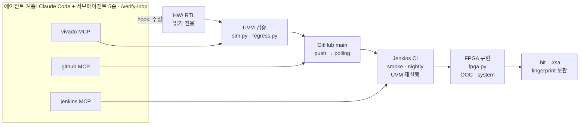

# dma_ip 검증·CI/CD 결과 보고서

> 이 보고서는 2026-11-14 시점의 기록이며 고치지 않습니다. 그 뒤의 ML 회귀, sign-off, 보드 시험,
> release 판정을 포함한 현재 상태는 `verif/SIGNOFF.md`에 있습니다.

2026-11-14 · 원본 문서: claude.ai 문서 "dma_ip 검증·CI/CD 결과 보고서"

## 요약

dma_ip(Zybo Z7-20)를 Vivado 2022.2 XSim 기반 UVM으로 검증했고, Jenkins CI와 비트스트림 CD까지 자동화했습니다. 계획한 P0~P6를 모두 마쳤고, Jenkins 빌드 #4~#13이 10회 연속 SUCCESS입니다. 마지막 빌드는 UVM 구조 재편 커밋을 빌드한 #13(`92ebb44`)입니다.

- **검증:** TB 6종(unit 5 + top 1), 테스트 총 17종. 전체 regression에서 예상과 다른 실패 0건이고, 실패하는 것은 알려진 RTL 버그 재현 테스트(XFAIL)뿐입니다.
- **커버리지:** top 기능 커버리지 `cg_job` 100%, `cg_burst` 100%. unit은 beat/cycle 커버리지 100%입니다.
- **발견한 RTL 문제 3건:** BUG-001(skid buffer 중복 beat, 고치지 않기로 결정), BUG-002(WDMA hang, 결정 대기), NOTE-001(100MHz 타이밍 여유 부족).
- **CD:** 전체 시스템을 100MHz로 구현해 WNS +0.003ns로 통과했습니다. 기본 구현 전략으로는 -0.347ns로 실패했고, 원래 수동 프로젝트도 -0.201ns로 실패하고 있었습니다.
- **자동화:** MCP 서버 3종(vivado, jenkins, github)과 서브에이전트 5종, RTL 수정을 막는 hook을 갖췄습니다.

남은 결정은 두 가지입니다. BUG-002를 RTL에서 고칠지, 그리고 NOTE-001의 근본 수정(burst 길이 계산 파이프라이닝)을 RTL 담당자에게 맡길지입니다.

## 전체 구조

RTL은 읽기 전용이고, 검증과 빌드는 모두 같은 스크립트(`sim.py`, `regress.py`, `fpga.py`)를 거칩니다. 사람, Jenkins, 에이전트가 모두 같은 경로를 쓰므로 로컬 결과와 CI 결과가 같습니다.



에이전트는 MCP로 검증, GitHub, Jenkins를 다루지만 `HW/` 수정은 hook이 막습니다. 단계별 산출물은 아래와 같습니다.

| 단계 | 산출물 |
| --- | --- |
| P0 | `sim.py`, XSim UVM 동작 확인, Windows XSim 문제 3건 우회 |
| P1 | 단위 UVM (fifo, skid, adder), BUG-001 발견 |
| P2 | top UVM (RAL, AXI4 메모리 모델, scoreboard), BUG-002 발견 |
| P3 | Jenkins CI (8090, JCasC), 병렬 regression |
| P4 | MCP 서버 3종 |
| P5 | 서브에이전트 5종, `/verify-loop`, RTL 보호 hook, 커버리지 100% |
| P6 | OOC 타이밍, 비트스트림 + XSA CD, NOTE-001 |
| 구조 재편 | UVM 코드를 파일 하나 = 클래스 하나로 정리, RAL 제거, AXI4 slave를 driver/monitor로 분리, job 실행을 시퀀스로 이동 |

## UVM 검증 환경

단위 블록 3개는 범용 valid/ready agent로, 전체 DMA는 AXI4-Lite 마스터와 AXI4 메모리 모델로 검증합니다. 구조는 사용자가 준 참고 UVM 코드(Agent/Driver/Monitor/Sequence)를 따르고, **파일 하나에 클래스 하나**(파일 이름 = 클래스 이름)로 정리했습니다. `*_pkg.sv`는 `` `include `` 목차만 담습니다. RAL은 쓰지 않고, 레지스터는 `axil_base_seq`의 `write_reg`/`read_reg`와 주소 상수(`dma_reg_map.sv`)로 직접 읽고 씁니다. 자세한 구조는 `docs/UVM_STRUCTURE.md`에 있습니다.

| 구성요소 | 역할 | 주요 검사 |
| --- | --- | --- |
| `vr_agent` | 범용 valid/ready agent (master, slave, passive) | 핸드셰이크 유지, X 값 SVA |
| `unit_env` | fifo, skid buffer, adder 단위 env | 순서를 지키는 scoreboard, 레인별 덧셈 모델(32bit, 8bit) |
| `axil_agent` + `axil_base_seq` | AXI4-Lite 제어 레지스터 접근 (0x00~0x24) | reset 값(10개, 32비트 전체), walking-1/0 쓰기·읽기 390회 |
| `axi4_slv_agent` | DDR을 대신하는 AXI4 slave. driver(응답, 바이트 메모리)와 monitor(burst 관찰)로 나뉨 | INCR, 8B 정렬, 16 beat 이하, 4KB 경계, WLAST 위치 |
| `dma_job_seq` / `dma_scoreboard` | DMA job 하나를 시퀀스로 실행하고 판정 | dst 모든 바이트 = src + value_to_add[7:0], guard band, 원본 보존, beat 합계 |
| `dma_coverage` | 기능 커버리지 | job 크기 × 완료 모드, burst 길이, 4KB 분할 |

하나의 DMA job은 SW 드라이버(`SW/mem_copy_test.c`)와 같은 순서로 레지스터를 쓰고, polling 또는 interrupt로 완료를 기다린 뒤 메모리를 바이트 단위로 비교합니다. 목적지 영역은 미리 예상값의 반전값으로 채워, 쓰지 않은 바이트는 반드시 불일치로 잡힙니다.

top의 adder는 `C_ADDER_BIT_WIDTH = 8`로 8bit 레인이고, 그 설정을 그대로 단위 TB `adder8`에서도 검증합니다.

## 검증 결과

모든 regression에서 예상과 다른 실패는 0건입니다. XFAIL은 전부 BUG-001, BUG-002 재현 테스트입니다.

| 실행 | 범위 | 실행 수 | 실패 | XFAIL |
| --- | --- | --- | --- | --- |
| Jenkins #7 (`a24e5bd`, smoke) | unit 전체 | 30 | 0 | 3 |
| Jenkins #7 (`a24e5bd`, smoke) | top smoke 6종 | 6 | 0 | 1 |
| 로컬 top regression (커버리지 수정 후) | top 11종 × seed 2 | 22 | 0 | 2 |
| 로컬 전체 regression (P3, 6개 병렬) | TB 6개 × seed 2 | 80 | 0 | 8 |
| 로컬 전체 regression (구조 재편 후, `92ebb44`) | TB 6개 × seed 3 | 123 | 0 | 12 |

| TB | 대상 | 테스트 |
| --- | --- | --- |
| `fifo`, `fifo_d4` | `sync_fifo` 깊이 64 / 4 | smoke, post_reset, rand, backpressure, trickle, fixed_side |
| `skid` | `skid_buffer` | 위와 같음 |
| `adder`, `adder8` | `axis_adder` 32bit / 8bit 레인 | 위와 같음 |
| `top` | `dma_ip_top` | reg_reset, reg_bitbash, smoke, small, rand, 4kb, backpressure, aw_backpressure, size_edge, irq, large(64KB) |

기능 커버리지는 top `cg_job` 100%, `cg_burst` 100%입니다. 다만 이 100%는 두 번째 측정치입니다. 처음 보인 100%는 XSim이 `$` 상한을 잘못 계산해 모든 job을 `huge` bin으로 세고 있었고, 이를 고치자 실제는 97.6%였습니다. 남은 구멍 2개(1 beat × interrupt, 512 beat × polling)는 `dma_size_edge_test`를 추가해 메웠습니다.

## 발견한 RTL 문제

검증에서 RTL 문제 3건을 찾았고, 원칙에 따라 `HW/`는 수정하지 않았습니다. 각 문제는 재현 테스트를 known-fail로 등록해 CI에서 XFAIL로 추적합니다. RTL이 고쳐지면 테스트가 통과(XPASS)하면서 CI가 알려줍니다. 자세한 내용은 `verif/BUGS.md`에 있습니다.

| ID | 블록 | 증상 | 원인 | 상태 |
| --- | --- | --- | --- | --- |
| BUG-001 | `skid_buffer.v` (FIFO 안에도 사용) | 리셋 직후 첫 사이클에 들어온 데이터가 두 번 출력되고 이후 데이터가 한 칸씩 밀림 | `PIPE` 상태가 `s_ready_reg`를 보지 않고 `s_valid`를 받음 | 고치지 않기로 결정 (보드에서는 리셋 한참 뒤에 데이터가 들어와 영향 낮음) |
| BUG-002 | `wdma.v` | AWREADY가 늦게 오면 WLAST가 3 beat 늦게 붙고 `ap_done`이 오지 않음 (hang) | `WVALID`가 W 상태와 무관하게 나가는데, burst 카운터는 RUN 상태에서만 셈 | 결정 대기. 실제 보드에서도 interconnect가 AWREADY를 늦추면 생길 수 있음 |
| NOTE-001 | RDMA/WDMA burst 주소 계산 | 100MHz에서 타이밍 여유가 거의 없음 (로직 17~22단) | 남은 beat, 16-beat 제한, 4KB 경계 계산을 한 사이클에 처리 | 구현 전략으로 임시 통과. 근본 수정은 RTL 담당자 판단 |

수정안은 모두 `verif/BUGS.md`에 적었습니다. BUG-001은 입력 캡처를 `s_ready_reg`로 거르는 것, BUG-002는 `WVALID`와 `s_ready`를 W RUN 상태로 거르는 것, NOTE-001은 burst 길이를 `S_PRE` 사이클에 미리 계산해 레지스터에 담는 것입니다.

## CI/CD

이 PC의 별도 Jenkins(포트 8090)가 `main`에 push될 때마다 검증과 FPGA 타이밍 검사를 돌리고, nightly에는 비트스트림과 XSA를 만듭니다. 설정은 모두 코드(JCasC, `Jenkinsfile`)로 저장소에 있고, 8080 포트의 기존 Jenkins 서비스는 건드리지 않았습니다.

| 트리거 | 실행 내용 |
| --- | --- |
| `main` push (5분 polling) | lint, unit 전체, top smoke 6종 (seed 1), DMA 단독 OOC 타이밍 |
| nightly 02:00 | 전체 테스트 × seed 5, 기능 커버리지 HTML, 비트스트림 + XSA |
| 수동 | `MODE`, `SEEDS`, `BITSTREAM` 지정 |

100MHz 시스템 타이밍은 구현 전략을 바꿔서야 통과했습니다. RTL과 블록 디자인은 그대로입니다.

| 빌드 | 구현 전략 | WNS | 실패 경로 수 |
| --- | --- | --- | --- |
| DMA 단독 (OOC) | 기본 | +0.014 ns | 0 |
| 원래 수동 프로젝트 | 기본 | -0.201 ns | 6 |
| CD 시스템 (`71cdca3`) | 기본 | -0.347 ns | 12 |
| CD 시스템 (`a24e5bd`, Jenkins #7) | `Performance_ExplorePostRoutePhysOpt` | +0.003 ns | 0 |

Jenkins #7은 약 28분 걸려 SUCCESS로 끝났고, 산출물은 fingerprint와 함께 보관됐습니다. `design_1_wrapper.bit`(4,045,676 bytes, sha256 `b2f5c4ab3f83632d…`)와 `design_1_wrapper.xsa`(679,419 bytes, sha256 `73ec31c475aae642…`)입니다. 같은 전략의 로컬 빌드 기준 리소스는 LUT 6,716개(12.6%), FF 12,180개(11.5%), BRAM 11.5개(8.2%)입니다.

비트스트림에 들어가는 IP는 빌드할 때마다 `HW/`에서 다시 조립합니다. 기존 IP에 패키징된 RTL은 `HW/`와 바이트 단위로 같았습니다. 그래서 보드에 올라가는 회로는 검증한 RTL 그대로입니다.

보고서 작성 후 빌드 #8~#13(`26650ff`, `bca3c5d`, `4c59418`, `9f8415a`, `ef24d9c`, `92ebb44`, 모두 smoke)도 SUCCESS입니다. 매번 unit 30회(XFAIL 3), top 6회(XFAIL 1), OOC WNS +0.014ns로 결과가 같고, 각 약 8.5~10.5분 걸렸습니다. #13은 UVM 구조 재편 후 첫 CI 빌드로, 재편 전과 같은 결과가 나왔습니다.

빌드 로그의 "Selected Git installation does not exist. Using Default"는 무시해도 되는 메시지입니다. git 플러그인이 5MB 미만 저장소에 JGit을 추천하려고 `jgit` 설치를 찾다가 없어서 남기고, 기본 `git.exe`로 정상 진행합니다. 처음에는 잘못 저장된 git 경로(`${GIT_EXE}`)가 원인이라고 보고 고쳤지만(`bca3c5d`) 메시지는 남았고, 플러그인 바이트코드를 확인해 진짜 원인을 `ci/README.md`에 정정해 기록했습니다(`4c59418`).

## MCP와 에이전트 오케스트레이션

에이전트가 시뮬레이션, CI, GitHub를 도구로 다루고, 서브에이전트가 계획부터 CI 확인까지 나눠 맡습니다. RTL 수정과 커밋은 항상 사람의 승인을 거칩니다.

| MCP 서버 | 도구 | 등록 위치 |
| --- | --- | --- |
| `vivado` (직접 제작) | 8개: list_testbenches, lint, run_test, get_log_excerpt, start_regression, regression_status, coverage_report, list_known_bugs | 저장소 `.mcp.json` |
| `jenkins` (공식 플러그인) | 23개 (getBuild, getTestResults, triggerBuild 등) | 로컬 설정 (토큰) |
| `github` (공식 원격 서버) | 46개 (PR, issue, review 등) | 로컬 설정 (토큰) |

`vivado` 서버는 `sim.py`를 그대로 호출해 에이전트가 보는 결과가 CI와 같습니다. 등록된 이름만 받고, shell을 거치지 않으며, 파일을 쓰는 도구가 없습니다. stdio self-test 12개가 통과했습니다.

| 서브에이전트 | 역할 | 쓰기 권한 |
| --- | --- | --- |
| verif-planner | 목표를 작업 목록으로 쪼갬 | vplan만 |
| uvm-builder | 작업 1개 구현, lint, seed 3개 실행 | `verif/` |
| sim-triage | 실패를 TB / RTL / 알려진 버그 / 환경으로 분류 | 없음 |
| coverage-closer | 커버리지 구멍을 자극으로 메움 | `verif/` |
| ci-watcher | Jenkins/GitHub 상태 보고 | 없음 |

`/verify-loop` skill이 이들을 계획 → 구현 → regression → 분류 → 커버리지 → CI 순서로 묶습니다. `PreToolUse` hook은 `HW/` 수정을 도구와 셀 명령 양쪽에서 막고, 단위 테스트 16개가 통과했습니다.

시연 루프 1회차에서 coverage-closer가 커버리지 구멍을 메우는 테스트를 만들었고, 그 과정에서 TB·도구 버그 2건(`huge` bin 오탐, 커버리지 리포트 누적)을 스스로 찾아 보고했습니다. 오케스트레이터가 두 버그를 직접 재현해 고쳤고, 정직한 수치로 다시 측정해 100%를 확인했습니다.

## Vivado XSim 2022.2 함정

아래 9건은 모두 실제로 결과를 틀리게 만들거나 빌드를 깨뜨렸고, 스크립트와 TB에 우회책을 넣었습니다. `CLAUDE.md`와 `verif/README.md`에도 적어 에이전트가 다시 만들지 않게 했습니다.

| 증상 | 영향 | 우회 |
| --- | --- | --- |
| `.bat` 래퍼가 `UVM_TESTNAME=x`의 `=`에서 인자를 자름 | xsim 실행 실패 | 인자를 따옴표로 감쌈 |
| 백슬래시 경로가 생성 C 코드에서 이스케이프로 해석됨 | code coverage 빌드 실패 | 모든 경로를 `/`로 전달 |
| `xcrg`가 성공해도 종료 코드 127 | 성공을 실패로 판정 | 로그 내용으로 판정 |
| `xcrg`가 리포트를 덮어쓰지 않고 뒤에 덧붙임 | 오래된 커버리지 수치를 읽음 | 리포트 폴더를 먼저 비움 |
| 넓은 범위 `dist` 분포가 크게 어긋남 (2%를 준 값이 51%) | adder overflow 경로를 한 번도 못 탐 | 코너값을 sequence에서 직접 선택 |
| coverpoint 안의 `33'()` 캐스트 식을 잘못 평가 | carry 커버리지 0 | 값을 미리 계산해 샘플 |
| bin 상한 `$`를 잘못 해석 | 모든 샘플이 `huge` bin에 잡힘 (거짓 100%) | 명시적인 상한 |
| `small`, `large` 등이 SV 예약어 | 컴파일 에러 | bin 이름 변경 |
| 함수 반환값에 비트 선택(`f()[3:0]`) 불가 | 컴파일 에러 | 임시 변수 사용 |

특히 `dist`와 `$` 문제는 에러 없이 통과하면서 숫자만 틀려져 알아차리기 어렵습니다. 두 건 모두 커버리지 리포트의 bin별 hit 수를 읽고서야 발견했습니다.

## 남은 과제

RTL 담당자의 결정 2건이 가장 급합니다. 나머지는 운영과 검증 범위를 넓히는 일입니다.

- [ ] BUG-002(WDMA hang)를 RTL에서 고칠지 결정 (RTL 담당자)
- [ ] NOTE-001 근본 수정: burst 길이 계산을 한 사이클 앞당김 (RTL 담당자). 지금 여유는 +0.003ns라 다음 변경에서 다시 실패할 수 있음
- [ ] 첫 nightly(full) 빌드의 타이밍과 seed 5개 regression 결과 확인
- [ ] 비트스트림을 실제 보드에 올려 SW 테스트(`mem_copy_test.c`)로 확인. CI에는 보드가 연결돼 있지 않음
- [ ] Claude Code 재시작 후 `vivado` MCP 서버 승인
- [ ] 재부팅 후 Jenkins(8090) 자동 시작 여부 결정. 지금은 `ci/start-jenkins.ps1`을 수동으로 실행해야 함
- [ ] 미검증 기능: `auto_restart`. 전송 크기 0 또는 8의 배수가 아닌 경우는 SW 사양상 금지라 제외했음
- [ ] `gh` 재로그인으로 토큰이 바뀌면 `github` MCP 재등록 (`mcp/README.md`)

## 부록: 재현 명령과 커밋 이력

모든 명령은 저장소 루트(`socdesignasic/dma-uvm`, private)에서 실행합니다. Jenkins도 같은 스크립트를 호출합니다.

```bash
python scripts/sim.py run --tb top --test dma_smoke_test --seed 1      # 테스트 1개
python scripts/regress.py --suite all --seeds 2 --jobs 6              # 전체 regression
python scripts/sim.py cov-report --tb top                             # 기능 커버리지
python scripts/sim.py run --tb top --test dma_aw_backpressure_test --seed 1   # BUG-002 재현
python scripts/fpga.py ooc                                            # DMA 단독 타이밍 (~3분)
python scripts/fpga.py system                                         # 비트스트림 + XSA (~18분)
powershell -ExecutionPolicy Bypass -File ci\start-jenkins.ps1        # Jenkins 8090 시작
```

| 커밋 | 내용 |
| --- | --- |
| `92ebb44` | UVM 구조 재편: 파일 하나 = 클래스 하나, RAL 제거 |
| `4c59418` | ci/README: git 로그 메시지 원인 정정 (JGit 추천 기능) |
| `bca3c5d` | Jenkins 기본 git 설치 사용 (잘못 저장된 git 경로 제거) |
| `26650ff` | docs/REPORT.md: 이 보고서의 저장소 사본 |
| `a24e5bd` | P6: 구현 전략 변경으로 100MHz 시스템 타이밍 통과 |
| `71cdca3` | P6: FPGA 구현 흐름 (OOC 타이밍, 비트스트림/XSA CD) |
| `0affc1a` | verify-loop 1회차: top 커버리지 100%, 커버리지 도구 버그 2건 수정 |
| `6e27113` | P5: 에이전트 오케스트레이션 (규칙, RTL 보호 hook, 서브에이전트, verify-loop) |
| `c503fa4` | P4: MCP 서버 3종 |
| `e7bf3be` | P3: Jenkins CI, 병렬 regression |
| `4d17661` | P2: top UVM, BUG-002 발견 |
| `b513e59` | BUG-001 고치지 않기로 결정 기록 |
| `bb08efa` | P1: 단위 UVM, BUG-001 발견 |
| `271bd7d` | P0: XSim UVM 시뮬레이션 인프라 |

주요 문서는 `verif/BUGS.md`(버그와 수정안), `verif/vplan/vplan.md`(기능 ↔ 테스트 ↔ 커버리지), `ci/README.md`(Jenkins와 FPGA), `mcp/README.md`(MCP 설정), `CLAUDE.md`(에이전트 규칙), 그리고 `docs/ARCHITECTURE.md`(저장소 구성), `docs/FLOW.md`(진행 흐름), `docs/UVM_STRUCTURE.md`(UVM 코드 구조)입니다.
